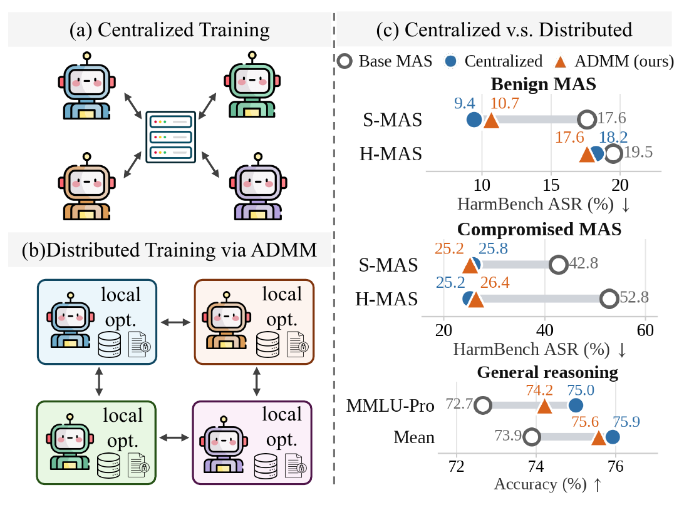

<div align='center'>

# Train Locally, Learn Together: Distributed Multi-Agent Training via ADMM

[](https://arxiv.org/abs/XXXX.XXXXX)
[](../../issues)
[](https://www.python.org/)
[](./LICENSE)

</div>

<table align="center">
  <tr>
    <td align="center">
      
      <br>
      <em style="font-size: 11px;"><strong style="font-size: 11px;">Figure 1:</strong> Schematic overview of centralized and distributed MAS training.</em>
    </td>
  </tr>
</table>

This is the official code repository for the paper [**Train Locally, Learn Together: Distributed Multi-Agent Training via ADMM**](https://arxiv.org/abs/XXXX.XXXXX).

Each agent of the MAS trains its own LoRA copy on role-local data, and agents only exchange parameters through ADMM consensus (ring all-reduce or gossip). No central trainer is needed.

## News

- 📢 [Oct 2026] We released the code and posted our paper on [arXiv](https://arxiv.org/abs/XXXX.XXXXX)! 🚀

## Installation

```bash
git clone https://github.com/OPTML-Group/Distributed-MAS
cd Distributed-MAS

conda create -n dmas python=3.10 -y
conda activate dmas
pip install -r requirements.txt

bash scripts/download_safety_data.sh
```

Models are pulled from Hugging Face: `Qwen/Qwen3-8B` (agents), `mlabonne/Qwen3-8B-abliterated` (compromised agent), `cais/HarmBench-Llama-2-13b-cls` and `Qwen/Qwen2.5-7B-Instruct` (judges).

## Quick Start

Safety training of the hierarchical MAS (H-MAS) with a compromised Synthesizer:

```bash
# collect rollouts and build the per-agent training data
bash scripts/safety/collect.sh hmas compromised

# train with ADMM (or: centralized / local / nodual)
bash scripts/safety/train.sh hmas compromised admm

# evaluate and judge
bash scripts/eval_safety.sh hmas-admm --method mas_trained \
    --ckpt ckpt/hmas-compromised-n4-admm-last.pt --prompt hierarchical \
    --agent_models synthesizer=mlabonne/Qwen3-8B-abliterated
```

Use `smas` / `sequential_v2` / `solver=...` for the sequential MAS, and `benign` for the setting without a compromised agent.

## Reproducing the Paper

The training arms differ only in how agents are coupled; hyper-parameters default to Table A2.

| Arm | `train.sh` | `train.py` flags |
|---|---|---|
| ADMM | `admm` | `--consensus ring` (gossip: `--consensus gossip --gossip_steps τ`) |
| Centralized | `centralized` | `--pooled --consensus coordinator` |
| ADMM-Local | `local` | `--local_only` |
| ADMM-NoDual | `nodual` | `--no_dual` |

The role-local objective is DPO (Eq. 8) by default. SFT objectives plug into the same ADMM updates: `--fit_mode sft` fits every collected message, and `--fit_mode rsft` fits only messages from successful rollouts (set `FIT_MODE` for `train.sh`). For example, `--prompt sequential_v2s --fit_prompt sequential_v2 --fit_mode sft` distills the safety-aware collection prompt into the deployment prompt.

**Safety (Table 1).** Run the Quick Start for each MAS (`smas`, `hmas`) and setting (`benign`, `compromised`) with the `centralized` and `admm` arms. The Base MAS row uses `--method text_mas` and the Single LLM row `--method baseline`; Table 2 uses the `local` and `nodual` arms.

**Reasoning (Fig. 4).**

```bash
python train.py --task mmlu_pro --anchor_offset 256 --think --reward outcome \
    --anchor_pool 64 --anchor_pass_band 0,1 --recollect_every 1 --k_outer 8 --rho 0.1 \
    --max_new_tokens 8192 --out ckpt/mmlu_pro-admm.pt
python run.py --method mas_trained --ckpt ckpt/mmlu_pro-admm-last.pt --task mmlu_pro \
    --max_samples 256 --reserve_tail 0 --think --max_new_tokens 8192
```

## Repository Layout

```
run.py              evaluation and trajectory collection (single LLM, Base MAS, trained MAS)
train.py            distributed / centralized training (Algorithm A1)
mas/                agents, role prompts (S-MAS, H-MAS), model wrapper, MAS inference
training/           B-only LoRA, DPO + KL objective, rollouts, ADMM trainer
consensus/          ADMM steps (Eqs. 7-10), ring all-reduce, gossip
evaluation/         benchmark loaders, answer scoring, HarmBench judge
tools/              build / label training data, judge results, merge shards
scripts/            data download, collection, training, safety evaluation
```

## Cite This Work

If you found our code or paper helpful, please cite our work~

```
@article{chen2026train,
  title={Train Locally, Learn Together: Distributed Multi-Agent Training via ADMM},
  author={Chen, Yiwei and Wang, Changsheng and Lang, Yicheng and Qu, Qing and Hero, Alfred O. and Liu, Sijia},
  journal={arXiv preprint arXiv:XXXX.XXXXX},
  year={2026}
}
```

